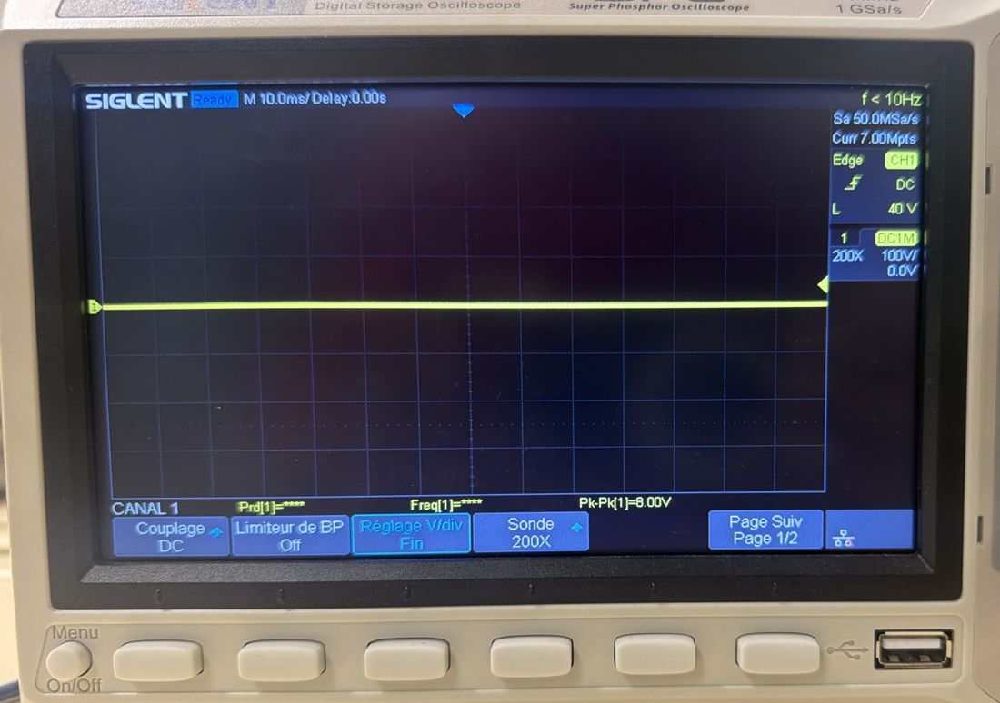

# Étape 5 — Réglage de l'oscilloscope Siglent

## Réglages (Siglent SDS1202X-E)

| Réglage | Valeur | Raison |
| --- | --- | --- |
| Entrée | CH1, couplage DC, 1 MΩ | Sortie BNC de la sonde différentielle |
| Sonde | 200X | Même rapport que la sonde (×200) |
| Échelle verticale | 100 V/div | ±325 V crête tiennent dans les 8 carreaux de hauteur |
| Base de temps | 10 ms/div | 5 périodes de 50 Hz à l'écran |
| Déclenchement | Front montant sur CH1, niveau 40 V, mode Auto | Trace visible même sans signal |
| Mesures | Pk-Pk, période, fréquence | Affichées en bas de l'écran |

## Statut du déclenchement

Sans tension sur le fil pilote, aucun front ne franchit 40 V : le statut alterne entre Arm, Ready et Auto, et l'oscilloscope se déclenche de lui-même. C'est normal. Dès qu'un ordre produit une tension, le déclenchement se stabilise.

## Trace de référence

Avant le premier ordre, la trace est plate : Pk-Pk de 8 V, soit du bruit de mesure.

---

[← Étape 4](04-decodeur-ttn.md) · [Retour au dossier ATIM](../README.md) · [Étape 6 : premiers downlinks →](06-downlinks-classe-c.md)