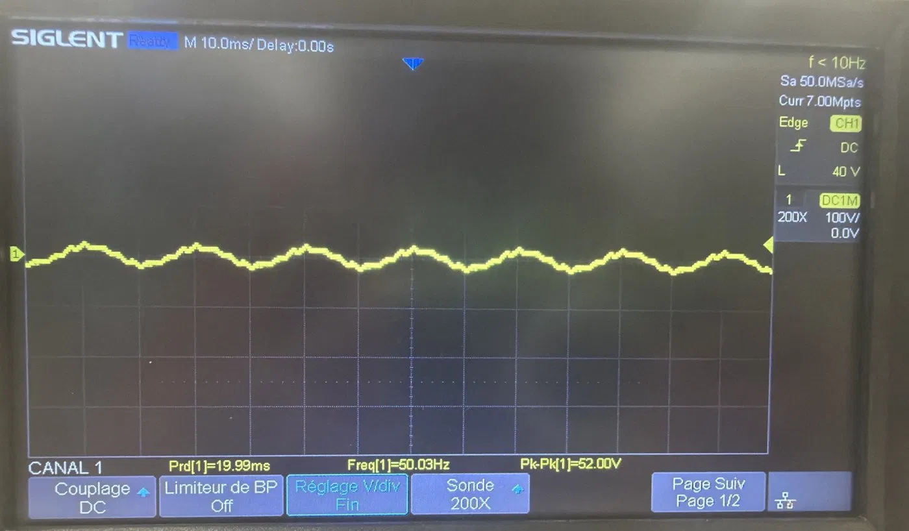
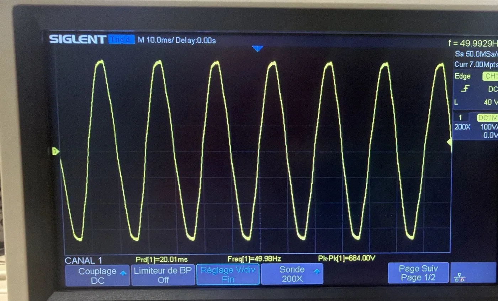
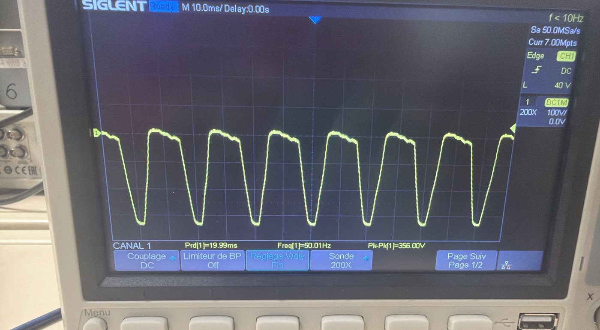
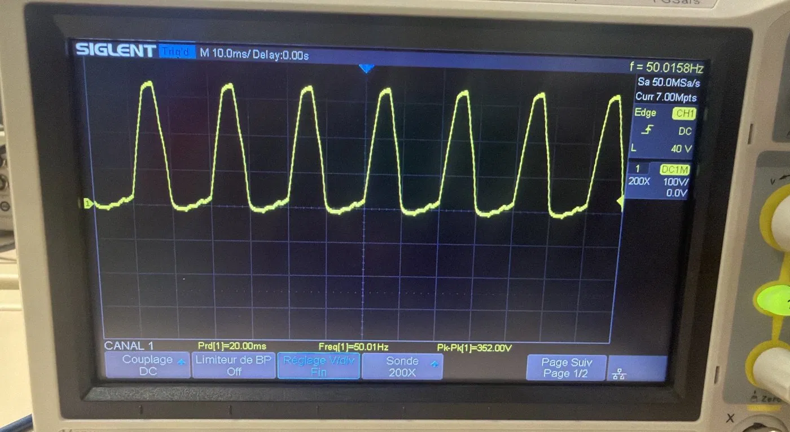

# Étape 7 — Mesure des ordres Confort, Éco, Hors gel et Arrêt

Chaque ordre est envoyé sur le FPort 1, puis le signal est mesuré entre le fil pilote et le neutre, avec les réglages de l'étape 5.

| Ordre | Octets | Signal attendu | Mesure |
| --- | --- | --- | --- |
| Confort | `25 01` | Aucun signal | Résidu de 52 V crête à crête, 50 Hz |
| Éco | `25 02` | Sinusoïde complète de 230 V | 684 V crête à crête, 50 Hz |
| Hors gel | `25 03` | Alternances négatives seules | 356 V crête à crête, 50 Hz |
| Arrêt | `25 04` | Alternances positives seules | 352 V crête à crête, 50 Hz |

## Remarques

- 230 V efficaces correspondent à 650 V crête à crête. Les 684 V mesurés donnent environ 242 V efficaces : tension du réseau ce jour-là et précision de la sonde.
- En Confort, la sortie n'est pas pilotée et, sans radiateur branché, elle reste en l'air : le résidu vient sans doute d'un couplage capacitif. Il n'apparaissait pas sur la trace de référence de l'étape 5.

## Oscillogrammes

### Confort (`25 01`)

### Éco (`25 02`)

### Hors gel (`25 03`)

### Arrêt (`25 04`)

---

[← Étape 6](06-downlinks-classe-c.md) · [Retour au dossier ATIM](../README.md) · [Étape 8 : correctif du décodeur →](08-correctif-decodeur.md)