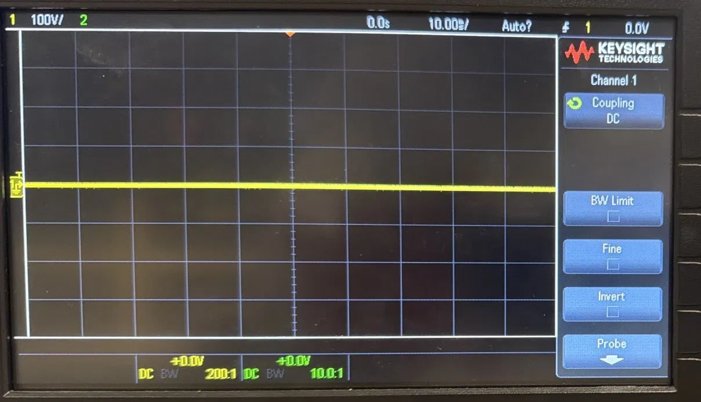
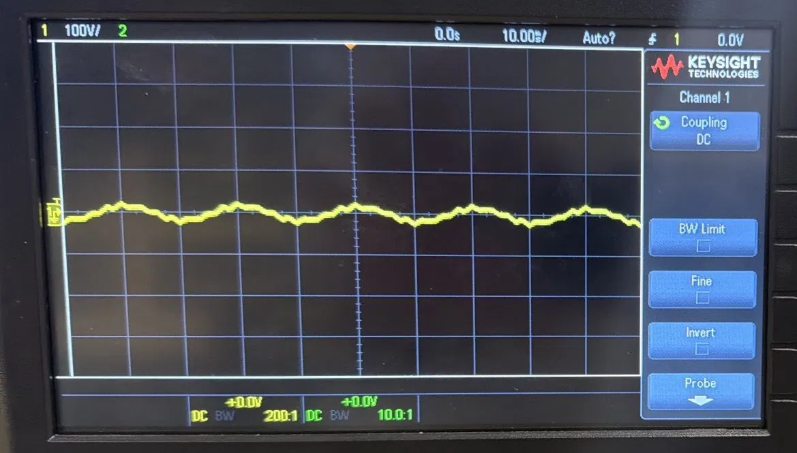

# Étape 9 — Réglage du Keysight et redémarrage du boîtier

Le 24/11, l'oscilloscope Siglent est remplacé par un Keysight EDUX1052A.

## Réglages (Keysight EDUX1052A)

| Réglage | Commande | Valeur |
| --- | --- | --- |
| Remise à zéro | Default Setup | Efface les réglages précédents (FFT active, 10 V/div, 2 s/div) |
| Rapport de sonde | Touche 1 → Probe → bouton Entry | 200:1 (pas de 1-2-5 : 10, 20, 50, 100, 200) |
| Échelle verticale | Bouton d'échelle de la voie 1 | 100 V/div |
| Base de temps | Gros bouton Horizontal | 10 ms/div |
| Déclenchement | Valeurs par défaut | Front montant sur CH1, 0 V, mode Auto |

Sur ce modèle, un seul jeu de boutons verticaux règle la voie sélectionnée.

## Sonde éteinte ou allumée ?

La sonde différentielle s'éteint seule au bout d'un moment. La trace permet de le voir :

| Trace | Signification |
| --- | --- |
| Trait parfaitement fin | Sonde éteinte |
| Petite ondulation à 50 Hz, environ 50 V crête à crête | Sonde allumée, aucun signal sur le fil pilote (résidu) |

## Redémarrage du boîtier

Remis sous tension le matin, le boîtier refait un join. Live data montre :

| Heure | Événement | Détail |
| --- | --- | --- |
| 09:19:46 | Join accepté | Nouvelle DevAddr : 260BC62D (260B0A5D la veille) |
| 09:19:55 | Trame de test | SF12 |
| 09:20:53 à 09:23:54 | 4 trames de test, une par minute | SF7 : l'ADR statique est appliqué |
| 09:23:59 | Trame de vie | 3,344 V à vide ; 3,339 V en charge |
| 09:24:05 | Trame de mesure | 20,31 °C ; 46,44 % |

Chaque trame de test et la trame de vie ont reçu un downlink de TTN, en réponse à la demande d'heure du module. Ce redémarrage a donc coûté 6 des 10 downlinks que la politique d'usage de TTN autorise par jour.

---

[← Étape 8](08-correctif-decodeur.md) · [Retour au dossier ATIM](../README.md) · [Étape 10 : Confort −1 °C et Confort −2 °C →](10-confort-moins-1-et-2.md)