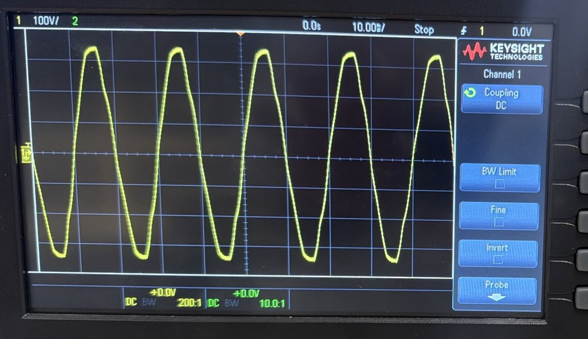
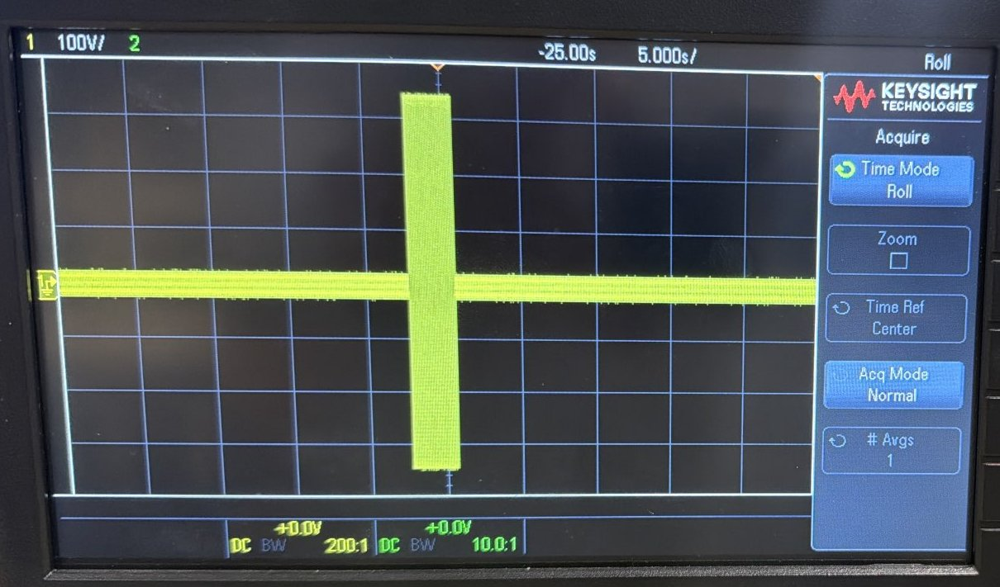
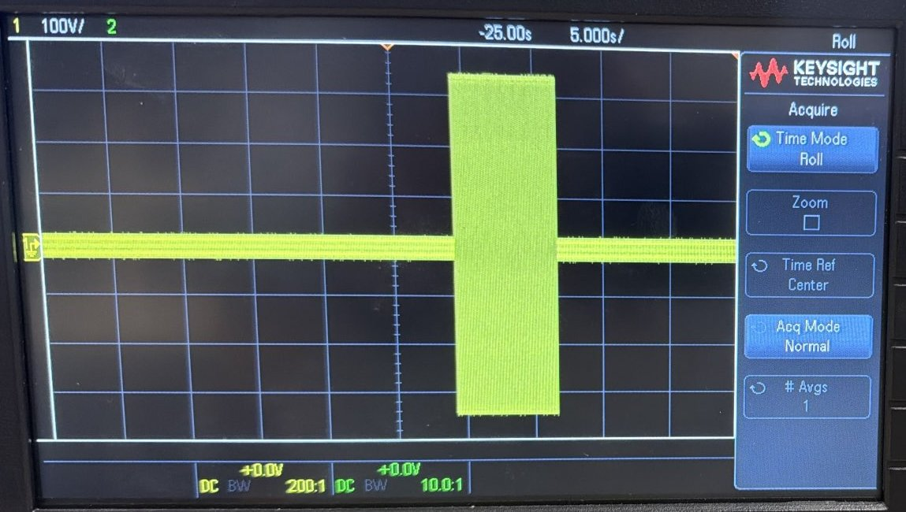

# Étape 10 — Ordres Confort −1 °C et Confort −2 °C

## Signal attendu

| Ordre | Octets | Signal sur le fil pilote |
| --- | --- | --- |
| Confort −1 °C | `25 05` | 230 V pendant 3 s, puis rien pendant 297 s (période de 5 min) |
| Confort −2 °C | `25 06` | 230 V pendant 7 s, puis rien pendant 293 s (période de 5 min) |

Une impulsion aussi courte et aussi rare ne se suit pas à 10 ms/div.

## Méthodes de capture essayées

| Méthode | Résultat |
| --- | --- |
| 10 ms/div, Run/Stop pendant l'impulsion | Fige 0,1 s de l'impulsion : on voit son contenu (sinusoïde complète, environ 700 V crête à crête), pas sa durée |
| Single à 2 s/div ou 50 s/div | Peu fiable : l'acquisition dure jusqu'à plusieurs minutes et l'écran reste vide jusqu'à la fin ; une sonde qui s'éteint ou un réglage modifié entre-temps fait tout perdre |
| Mode Roll à 5 s/div (Acquire → Time Mode → Roll) | Fonctionne : le signal défile en direct sur 50 s, et Run/Stop fige l'écran quand le bloc est visible |

## Résultats (mode Roll, 5 s/div, 100 V/div)

| Ordre | Largeur du bloc | Durée | Heure observée |
| --- | --- | --- | --- |
| Confort −1 °C | 0,6 carreau | Environ 3 s | Vers 10:06:20 |
| Confort −2 °C | 1,5 carreau | Environ 7 s | Début vers 10:12:25 |

Le bloc fait 7 carreaux de haut (environ 700 V crête à crête) : pendant l'impulsion, le fil pilote reçoit le signal Éco.

## Observations

- Le premier créneau arrive une dizaine de secondes après l'ordre : `25 06` est accepté à 10:12:14, et l'impulsion commence vers 10:12:25.
- Tout indique que chaque nouvel ordre relance le cycle de 5 minutes. Le `25 05` renvoyé six fois entre 09:37 et 09:56 a coûté six downlinks et repoussé l'impulsion suivante : un ordre accepté (`06 00`) ne doit pas être renvoyé.
- L'impulsion de 10:06:20 arrive environ 10 minutes, soit deux périodes, après le dernier `25 05` (09:56:19).
- Les heures sont lues sur les photos de l'écran, à quelques secondes près.

## Oscillogrammes

### Contenu d'une impulsion (10 ms/div)

### Confort −1 °C (mode Roll, 5 s/div)

### Confort −2 °C (mode Roll, 5 s/div)

---

[← Étape 9](09-oscilloscope-keysight.md) · [Retour au dossier ATIM](../README.md) · [Étape 11 : calendrier et réglages →](11-calendrier-et-reglages.md)