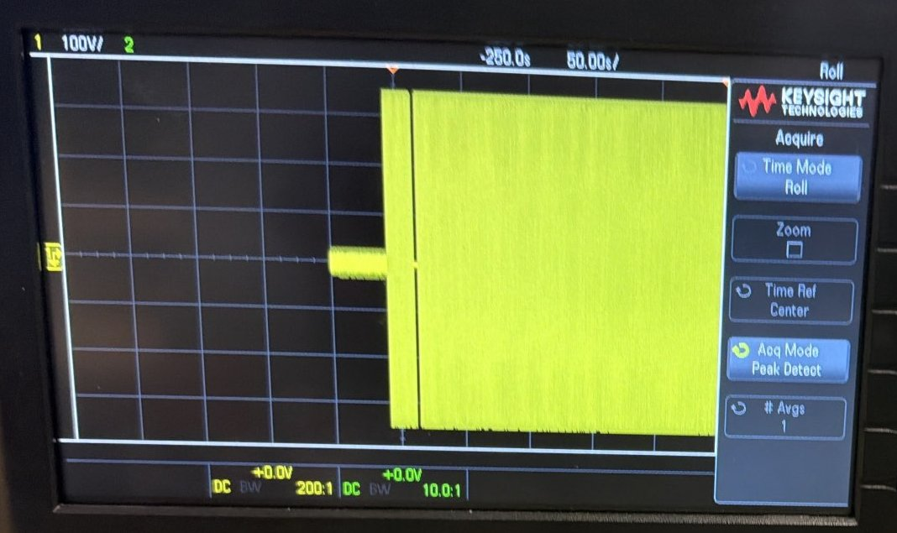
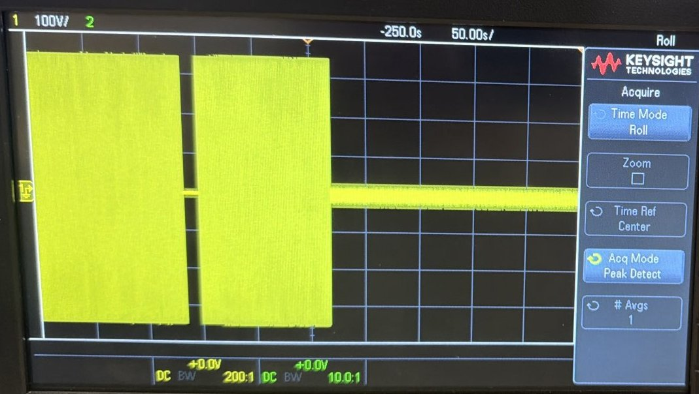

# Étape 11 — Décodeur v3, calendrier et réglage des envois

## Décodeur v3

Le décodeur est étendu avant les envois suivants. La relecture de la configuration (étape 12) répond par une trame de commande, attendue en `07` au lieu de `87`. Avec l'horodatage, une réponse aurait aussi son bit 6 à 1 (`46`, `47`, `48`).

```js
function decodeUplink(input) {
    var b = input && input.bytes;
    if (b && b.length > 0 && (b[0] & 0x80) === 0) {
        var type = b[0] & 0x3F;              // type, sans les bits 7 et 6
        if (type === 0x06 || type === 0x07 || type === 0x08) {
            var copie = [];
            for (var i = 0; i < b.length; i++) copie.push(b[i]);
            copie[0] = b[0] | 0x80;             // 06 -> 86, 47 -> C7...
            return decodeUplinkATIM({ bytes: copie, fPort: input.fPort, variables: input.variables });
        }
    }
    return decodeUplinkATIM(input);
}
```

Fichier : [`acw-pw-codec-ttn-v3.js`](../codec/acw-pw-codec-ttn-v3.js), 30 627 octets. Les 23 exemples d'ATIM donnent toujours le même résultat.

## Calendrier : principe

- Jusqu'à 7 programmes `HH:MM-HH:MM;jours;mode`, en heure UTC (Paris = UTC+1 en hiver).
- Jours : lundi = 1, mardi = 2, mercredi = 4, jeudi = 8, vendredi = 16, samedi = 32, dimanche = 64 ; tous les jours = 127.
- Hors des programmes, le module applique un mode par défaut.
- Le calendrier ne s'applique que si le mode du fil pilote vaut 0 (`25 00`).

## Downlink envoyé à 10:24:27 (22 octets)

`0B 01 03 06 D4 03 01 0A 00 25 00 26 02 DE 07 00 24 42 4E 7F 01 03`

| Octets | Paramètre | Valeur |
| --- | --- | --- |
| `0B 01` | Horodatage des trames | Activé |
| `03 06` | Période de la trame de vie | Une par jour |
| `D4 03 01 0A 00` | Période d'enregistrement | 10 min |
| `25 00` | Mode du fil pilote | Calendrier |
| `26 02` | Mode par défaut du calendrier | Éco |
| `DE 07 00 24 42 4E 7F 01 03` | Programme 1 | Confort, tous les jours, 09:40-09:50 UTC (10:40-10:50 à Paris) |

Codage du programme 1 : `DE` (programme 1) · `07` (longueur) · `00` · `24 42 4E` (deux heures en minutes sur 12 bits : 0x244 = 580 = 09:40 et 0x24E = 590 = 09:50) · `7F` (127 : tous les jours) · `01` (Confort) · `03` (octet final).

Une seule trame de vie par jour : chacune déclenche une réponse horaire de TTN, donc un downlink. Une par heure en coûterait 24 par jour.

## Résultats

| Heure | Observation |
| --- | --- |
| 10:24:29 et 10:24:34 | Deux trames de vie, déjà horodatées, chacune suivie d'un downlink de TTN |
| Vers 10:24:35 | Le fil pilote passe en Éco (mode par défaut, hors programme) |
| 10:24:40 | Réponse `06 00` : les six paramètres sont acceptés |
| 10:24:46, 10:34:35, 10:44:35 | Trames de mesure toutes les 10 min, horodatées 09:24:28, 09:34:30 et 09:44:30 UTC |
| Vers 10:41 | Passage en Confort, environ une minute après l'heure programmée |

- Avant ce réglage, le module envoyait une mesure par heure (09:24:05, puis 10:24:04).
- Le retour en Éco, prévu à 10:50, n'a pas été relevé.
- La trame de vie quotidienne reste à vérifier le 25/11.

## Oscillogrammes (mode Roll, 50 s/div)

À 50 s/div, le mode Peak Detect (Acquire → Acq Mode) garde le minimum et le maximum de chaque intervalle : aucune impulsion n'échappe à l'affichage.

### Passage en Éco à la réception du downlink



La fine coupure vers 10:24:55 correspond à l'extinction de la sonde.

### Passage en Confort vers 10:41



La coupure vers 10:39 vient sans doute aussi de la sonde.

---

[← Étape 10](10-confort-moins-1-et-2.md) · [Retour au dossier ATIM](../README.md) · [Étape 12 : relecture de la configuration →](12-relecture-configuration.md)