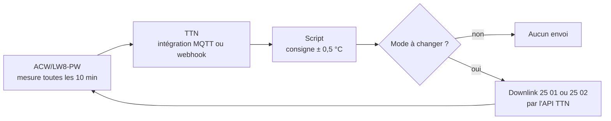

# Étape 13 — Bilan et perspectives

## Bilan

| Objectif | Résultat |
| --- | --- |
| Rejoindre TTN en OTAA | Atteint (étapes 2 et 3) |
| Décoder les trames montantes | Atteint : décodeur ATIM allégé, puis corrigé (v1 à v3) |
| Envoyer des ordres | Atteint, après réglage de la classe C et de l'ADR (étape 6) |
| Vérifier les six ordres à l'oscilloscope | Atteint (étapes 7 et 10) |
| Calendrier embarqué | Atteint : passage d'Éco à Confort sans downlink, une minute après l'heure prévue (étape 11) |
| Relecture de la configuration | Atteint : conforme à l'envoi (étape 12) |
| Réglage des envois | Atteint : horodatage, mesures toutes les 10 min (étape 11) |

## Downlinks du 24/11

| Origine | Nombre |
| --- | --- |
| Envoyés par nous : 6 × `25 05`, `25 06`, calendrier et réglages, relecture | 9 |
| Automatiques : réponses de TTN aux demandes d'heure, ADR | 9 |
| Total | 18, pour 10 autorisés par jour |

Pour rester sous la limite : regrouper les réglages dans un seul downlink, ne pas renvoyer un ordre accepté, et éviter de redémarrer le boîtier (6 downlinks à chaque fois).

## À vérifier

- [ ] Retour en Éco à la fin du programme (10:50 à Paris) et écart d'une minute au début.
- [ ] Trame de vie quotidienne, le 25/11.
- [ ] Signal avec un vrai radiateur branché : le résidu en Confort devrait disparaître.
- [ ] Câblage interne du boîtier de test, à ajouter à l'étape 1.

## Perspective : thermostat connecté

Principe proposé, non réalisé :

- La limite de 10 downlinks par jour impose une hystérésis et une durée minimale entre deux ordres.
- Le calendrier embarqué gère les horaires habituels sans downlink ; le script ne traite que les écarts.
- `25 01` ou `25 02` suspend le calendrier, et `25 00` le réactive.

---

[← Étape 12](12-relecture-configuration.md) · [Retour au dossier ATIM](../README.md)